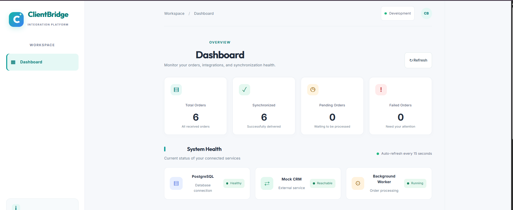
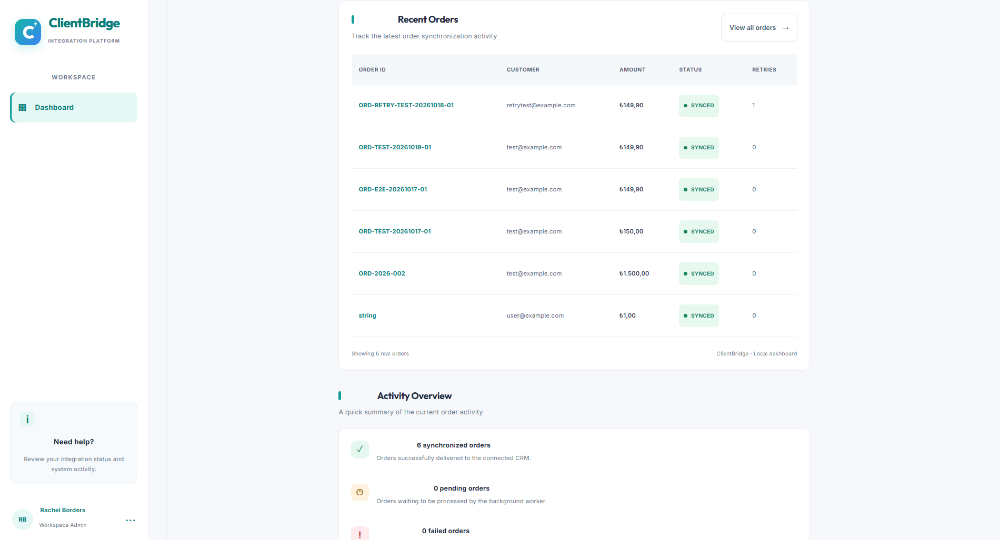

# ClientBridge

**Sipariş Senkronizasyonu ve Entegrasyon İzleme Paneli**

ClientBridge, NovaShop Commerce üzerinden gelen sipariş webhook'larını güvenli biçimde kaydeden, siparişleri arka planda CRM sistemine aktaran ve entegrasyon bileşenlerinin sağlık durumunu izlemeyi amaçlayan bir uygulamadır.

React tabanlı kullanıcı arayüzü, FastAPI backend, PostgreSQL veritabanı ve arka plan worker yapısıyla sipariş entegrasyon süreçlerini tek bir yerde takip etmeyi hedefler.

## Ekran Görüntüleri

### Dashboard



### Siparişler ve Aktivite Özeti



## Özellikler

- **Sipariş takibi:** Siparişlerin durumlarını ve ilgili bilgileri görüntüleme.
- **Asenkron işleme:** Webhook isteğini kabul ettikten sonra CRM senkronizasyonunu arka planda yürütme.
- **Kalıcı kayıt:** Siparişleri işlem başlamadan önce veritabanına kaydetme.
- **Yinelenen sipariş kontrolü:** Aynı siparişin tekrar işlenmesini önlemeye yönelik kontroller.
- **Worker yönetimi:** Siparişleri arka plan işlemcisi üzerinden işleme.
- **Retry mekanizması:** Geçici hatalarda üstel gecikme ve jitter ile yeniden deneme.
- **Recovery mekanizması:** Uzun süre işlem görmeyen kayıtları yeniden işlenebilir hâle getirme.
- **Lease koruması:** İşlem sahipliğini kaybetmiş eski worker'ların kayıtları değiştirmesini önleme.
- **Sistem sağlığı:** Veritabanı, CRM ve worker durumlarını takip etme.
- **REST API ve Swagger:** Backend endpoint'lerini inceleme ve test etme.

## Proje Mimarisi

```text
NovaShop Commerce
        |
        | Order Webhook
        v
   FastAPI Backend
        |
        | Siparişi kaydet
        | HTTP 202 döndür
        v
    PostgreSQL
        |
        v
 Background Worker
        |
        | CRM isteği
        v
     Mock CRM
        |
        +---- Başarılı ----> SYNCED
        |
        +---- Geçici hata --> Retry
        |
        +---- Limit aşıldı -> FAILED
```

### Sipariş İşleme Akışı

1. **Webhook:** Sipariş isteği API tarafından alınır.
2. **Kayıt:** Sipariş `PENDING` durumuyla veritabanına kaydedilir.
3. **Yanıt:** Yeni sipariş kabul edildiğinde API `202 Accepted` döndürür.
4. **Claim:** Worker, uygun siparişi `SELECT ... FOR UPDATE SKIP LOCKED` kullanarak işlem için alır.
5. **Senkronizasyon:** Sipariş CRM'e `Idempotency-Key` başlığıyla gönderilir.
6. **Başarı:** İşlem tamamlanırsa sipariş `SYNCED` durumuna geçer.
7. **Retry:** HTTP 429, HTTP 5xx ve timeout gibi geçici hatalarda yapılandırmaya bağlı yeniden deneme uygulanabilir.
8. **Recovery:** Uzun süredir işlem görmeyen kayıtlar tekrar kuyruğa alınabilir.
9. **Lease kontrolü:** Eski worker'ların güncel işlem sonucunu ezmesi engellenmeye çalışılır.

> Teknik ayrıntılar mevcut kod ve yapılandırmayla doğrulanmalıdır. Özellikle yinelenen siparişlerin HTTP yanıtı, retry sınırları ve recovery süreleri uygulamanın gerçek davranışına göre değerlendirilmelidir.

## Kullanılan Teknolojiler

| Teknoloji | Kullanım amacı |
|---|---|
| React | Kullanıcı arayüzü |
| Vite | Frontend geliştirme ve derleme |
| JavaScript | Frontend uygulama mantığı |
| CSS | Arayüz tasarımı |
| Python | Backend geliştirme |
| FastAPI | REST API ve webhook endpoint'leri |
| PostgreSQL | Kalıcı veri saklama |
| SQLAlchemy | Veritabanı işlemleri ve ORM |
| asyncpg | Asenkron PostgreSQL bağlantısı |
| Alembic | Veritabanı şema migrasyonları |
| Pydantic | Veri doğrulama ve ayarlar |
| HTTPX | HTTP istekleri ve CRM iletişimi |
| Docker Compose | Servisleri birlikte çalıştırma |

Frontend teknolojilerini ve test araçlarını yayınlamadan önce `frontend/package.json` ve projedeki gerçek test dosyalarıyla doğrula.

## Dosya ve Klasör Yapısı

```text
clientbridge/
├── clientbridge/
│   └── app/
│       ├── api/
│       ├── core/
│       ├── models/
│       ├── schemas/
│       ├── services/
│       ├── workers/
│       │   └── polling_worker.py
│       └── main.py
├── frontend/
│   ├── src/
│   │   ├── App.jsx
│   │   └── App.css
│   └── package.json
├── docs/
│   └── images/
│       ├── dashboard.png
│       └── orders-activity.png
├── requirements.txt
└── README.md
```

Bu yapı, bilinen klasör düzenine göre hazırlanmıştır. GitHub'a göndermeden önce klasör ve dosya adlarını gerçek proje yapısıyla karşılaştır.

### Önemli Dosyalar

| Dosya / klasör | Görevi |
|---|---|
| `frontend/src/App.jsx` | Dashboard bileşenleri |
| `frontend/src/App.css` | Dashboard stilleri |
| `clientbridge/app/main.py` | FastAPI uygulamasının başlangıç noktası |
| `clientbridge/app/api/` | API endpoint'leri |
| `clientbridge/app/core/` | Yapılandırma ve ortak bileşenler |
| `clientbridge/app/models/` | Veritabanı modelleri |
| `clientbridge/app/schemas/` | İstek ve yanıt şemaları |
| `clientbridge/app/services/` | Uygulama servisleri |
| `clientbridge/app/workers/polling_worker.py` | Arka plan işleme döngüsü |
| `requirements.txt` | Python bağımlılıkları |
| `frontend/package.json` | Frontend bağımlılıkları ve npm komutları |
| `docs/images/` | README ekran görüntüleri |

## Kurulum

### Gereksinimler

- Python
- Node.js ve npm
- PostgreSQL veya projenin Docker yapılandırması
- Git
- Docker Desktop (Docker Compose ile çalıştırmak için)

### 1. Projeyi Klonlayın

```bash
git clone YOUR_GITHUB_REPOSITORY_URL
cd clientbridge
```

`YOUR_GITHUB_REPOSITORY_URL` yerine GitHub depo adresinizi yazın.

### 2. Python Ortamını Hazırlayın

Proje kök dizininde sanal ortam oluşturun:

```bash
python -m venv .venv
```

Windows PowerShell'de etkinleştirin:

```powershell
.\.venv\Scripts\Activate.ps1
```

Bağımlılıkları yükleyin:

```bash
python -m pip install -r requirements.txt
```

### 3. Ortam Değişkenlerini Ayarlayın

Projede `.env.example` dosyası bulunuyorsa kopyalayın:

```powershell
Copy-Item .env.example .env
```

`.env` içindeki veritabanı, CRM bağlantısı ve worker ayarlarını projenin yapılandırmasına göre düzenleyin. Gerçek şifreleri ve erişim anahtarlarını GitHub'a yüklemeyin.

### 4. Servisleri Başlatın

Projede Docker Compose yapılandırması varsa proje kökünde:

```bash
docker compose up --build
```

Veritabanı, migrasyon, API ve worker başlangıç sırası Compose yapılandırmasına bağlıdır.

### 5. Backend'i Yerel Olarak Başlatın

Backend kodları içteki `clientbridge` klasöründeyse, ana proje klasöründen:

```powershell
cd clientbridge
```

Ana klasördeki sanal ortamı kullanarak:

```powershell
..\.venv\Scripts\python.exe -m uvicorn app.main:app --reload
```

Backend'in varsayılan adresi `http://127.0.0.1:8000` olur.

### 6. Worker'ı Başlatın

Yeni bir terminal açıp içteki backend klasörüne gidin. Projenin gerçek konumuna göre yolu düzenleyin:

```powershell
cd C:\Users\user\OneDrive\Desktop\clientbridge\clientbridge
```

Worker'ı başlatın:

```powershell
..\.venv\Scripts\python.exe -m app.workers.polling_worker
```

Bu komut, worker modülünün belirtilen konumda bulunduğunu varsayar. Docker Compose kullanılıyorsa worker'ı ayrıca başlatmak gerekmeyebilir.

### 7. Frontend'i Başlatın

Yeni bir terminalde proje köküne dönüp frontend klasörüne girin:

```powershell
cd C:\Users\user\OneDrive\Desktop\clientbridge\frontend
```

Paketleri yükleyin ve geliştirme sunucusunu çalıştırın:

```bash
npm install
npm run dev
```

Vite'ın terminalde gösterdiği adresi açın. Varsayılan adres genellikle `http://localhost:5173/` olur.

## API Endpoint'leri

| Metot | Endpoint | Amaç |
|---|---|---|
| `POST` | `/webhooks/orders` | Sipariş webhook'u almak |
| `GET` | `/orders` | Siparişleri listelemek |
| `GET` | `/health/ready` | Sistem hazır olma durumunu kontrol etmek |
| `GET` | `/docs` | Swagger API dokümantasyonu |

Endpoint'lerin ve istek şemalarının güncel durumunu backend çalışırken Swagger UI üzerinden doğrulayabilirsiniz.

### Sistem Sağlığını Kontrol Etme

```bash
curl http://127.0.0.1:8000/health/ready
```

### Siparişleri Listeleme

```bash
curl http://127.0.0.1:8000/orders
```

### Swagger UI

Tarayıcıda `http://127.0.0.1:8000/docs` adresini açın.

## Yapılandırma ve Güvenilirlik

Worker davranışı ve bağlantılar ortam değişkenleri üzerinden yapılandırılabilir. Projede mevcutsa şu ayarlar `.env.example` içinde tanımlanır:

- `HEARTBEAT_INTERVAL_SECONDS`
- `HEARTBEAT_TIMEOUT_SECONDS`
- `MAX_RETRIES`
- Veritabanı bağlantı ayarları
- CRM servis adresi

### Tasarım Kararları

- Siparişi işleme başlamadan önce veritabanına kaydetmek.
- Birden fazla worker'ın aynı siparişi eş zamanlı almasını engellemek.
- Geçici hatalarda kontrollü yeniden deneme uygulamak.
- Heartbeat ile uzun süren veya yarım kalan işlemleri takip etmek.
- Lease token ile işlem sahipliğini kontrol etmek.
- API ve worker bileşenlerini birbirinden ayırmak.

## Testler

Projede testler ve gerekli test bağımlılıkları mevcutsa sanal ortam etkin durumdayken:

```bash
python -m pytest
```

Test kapsamı, gerçekten mevcut test dosyaları ve çalıştırma sonuçları üzerinden değerlendirilmelidir.

## Gelecekte Eklenebilecek Özellikler

- Gerçek bir CRM servisiyle entegrasyon
- Kullanıcı girişi ve rol tabanlı yetkilendirme
- Gelişmiş log görüntüleme ve filtreleme
- Gerçek zamanlı bildirimler
- Daha ayrıntılı hata raporlama ve metrikler
- CI/CD pipeline entegrasyonu
- Otomatik deployment ve health check süreçleri
- Daha kapsamlı entegrasyon testleri

## Projenin Amacı

ClientBridge; API geliştirme, veritabanı yönetimi, frontend-backend iletişimi, arka plan görevleri, hata yönetimi ve sistem izleme konularında uygulamalı deneyim kazanmak amacıyla geliştirilmiştir.

---

# ClientBridge

**Order Synchronization and Integration Monitoring Dashboard**

ClientBridge is a full-stack application designed to receive order webhooks, persist order data, synchronize orders with an external CRM service, and monitor integration health.

It combines a React frontend, a FastAPI backend, PostgreSQL, and background processing to provide a centralized view of order integration workflows.

## Screenshots

### Dashboard


### Orders and Activity Overview


## Key Features

- **Order tracking:** View orders and their current statuses.
- **Asynchronous processing:** Process CRM synchronization in the background.
- **Persistent storage:** Store orders before processing begins.
- **Duplicate protection:** Detect repeated order submissions.
- **Background workers:** Process synchronization jobs independently from incoming requests.
- **Retry handling:** Retry transient errors using exponential backoff and jitter.
- **Recovery mechanism:** Return stale jobs to a processable state.
- **Lease protection:** Reduce the risk of stale workers overwriting newer results.
- **Health monitoring:** Inspect the readiness of integration components.
- **REST API and Swagger:** Explore and test backend endpoints.

## Architecture

```text
NovaShop Commerce
        |
        | Order Webhook
        v
   FastAPI Backend
        |
        | Persist order
        | Return HTTP 202
        v
    PostgreSQL
        |
        v
 Background Worker
        |
        | CRM request
        v
     Mock CRM
        |
        +---- Success ----> SYNCED
        |
        +---- Temporary Error --> Retry
        |
        +---- Retry Limit ------> FAILED
```

## Technology Stack

| Technology | Purpose |
|---|---|
| React | User interface |
| Vite | Frontend development and build tooling |
| JavaScript | Frontend application logic |
| CSS | UI styling |
| Python | Backend development |
| FastAPI | REST API and webhook endpoints |
| PostgreSQL | Persistent data storage |
| SQLAlchemy | Database ORM |
| asyncpg | Asynchronous PostgreSQL driver |
| Alembic | Database migrations |
| Pydantic | Data validation and settings |
| HTTPX | HTTP communication with the CRM |
| Docker Compose | Local multi-service orchestration |

Verify frontend and testing technologies against the actual project files before publishing.

## Installation

### Prerequisites

- Python
- Node.js and npm
- PostgreSQL or the project's Docker configuration
- Git
- Docker Desktop, if using Docker Compose

### 1. Clone the Repository

```bash
git clone YOUR_GITHUB_REPOSITORY_URL
cd clientbridge
```

### 2. Set Up Python

```bash
python -m venv .venv
```

Activate the environment in Windows PowerShell:

```powershell
.\.venv\Scripts\Activate.ps1
```

Install the dependencies:

```bash
python -m pip install -r requirements.txt
```

### 3. Configure the Environment

If `.env.example` exists, copy it to `.env` and configure the database, CRM, and worker settings. Never commit real credentials or secrets.

### 4. Start the Services

If the repository includes a Docker Compose configuration:

```bash
docker compose up --build
```

The actual service startup order is determined by the Compose configuration.

### 5. Run the Backend Locally

If the backend is located in the inner `clientbridge` directory, enter that directory and run:

```powershell
..\.venv\Scripts\python.exe -m uvicorn app.main:app --reload
```

The default backend address is `http://127.0.0.1:8000`.

### 6. Run the Worker

From the inner backend directory, run:

```powershell
..\.venv\Scripts\python.exe -m app.workers.polling_worker
```

If the worker is already managed by Docker Compose, a separate local worker may not be needed.

### 7. Run the Frontend

From the `frontend` directory:

```bash
npm install
npm run dev
```

Open the local URL printed by Vite, usually `http://localhost:5173/`.

## API Endpoints

| Method | Endpoint | Purpose |
|---|---|---|
| `POST` | `/webhooks/orders` | Receive order webhooks |
| `GET` | `/orders` | List orders |
| `GET` | `/health/ready` | Check application readiness |
| `GET` | `/docs` | Open Swagger documentation |

### Check Readiness

```bash
curl http://127.0.0.1:8000/health/ready
```

### List Orders

```bash
curl http://127.0.0.1:8000/orders
```

### Swagger UI

Open `http://127.0.0.1:8000/docs` in a browser.

## Reliability and Configuration

Depending on the actual implementation, worker settings may include heartbeat intervals, timeout thresholds, retry limits, database connection details, and the CRM base URL. Consult `.env.example` and the implementation for the supported settings.

Important design principles include persisting accepted orders, coordinating workers with database locking, retrying transient failures, detecting stale jobs, and validating worker ownership before updating records.

## Testing

If the project contains tests and the required test dependencies are installed, run:

```bash
python -m pytest
```

## Potential Future Improvements

- Integration with a real CRM provider
- User authentication and role-based authorization
- Advanced logs and monitoring metrics
- Real-time notifications
- CI/CD pipeline integration
- Automated deployment and health checks
- More comprehensive integration tests

## Project Goal

ClientBridge was developed to gain practical experience with API development, database management, frontend-backend communication, background processing, error handling, and integration monitoring.

---

**Author:** Ekin Alkan

**GitHub:** [ekinalkan1334-engineering](https://github.com/ekinalkan1334-engineering)
